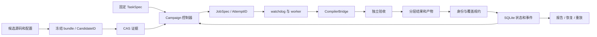

# 架构与模块连接

本文件描述 0.5.0 的实际实现。控制器是确定性状态机，agent 通过数据协议参与；
没有新增 Supervisor agent，也没有由 LLM 决定正式评测通过或设备作业权限。

## 模块和所有权

| 模块 | 实现 | 输入、输出和边界 |
| --- | --- | --- |
| 任务与参考 | `contracts.py`、`tasks/`、`fixtures/` | 严格 TaskSpec、固定 case、独立 oracle、基线和源码身份 |
| 候选 | `bundle.py` | 冻结整个 bundle、入口和配置；拒绝路径逃逸及任务参数覆盖 |
| 实验证据 | `artifacts.py`、`store.py` | CAS 原子写入，SQLite 事务登记状态/事件；JSON 仅为导出视图 |
| 实验控制 | `experiments.py`、`budget.py` | trial、阶段、修复父子关系、generation/token/evaluation/墙钟预算 |
| Skill 与生成 | `generation.py`、`skill_workflow.py` | 原文件引用闭包和哈希、小块交付、响应及证据检查 |
| 外部 runtime | `generator_worker.py` | file 或 command 交接；不依赖模型 SDK；命令具有独立 deadline |
| 作业 | `protocol.py`、`runner.py`、`watchdog.py`、`worker.py` | 严格 JobSpec、Linux session、超时、进程身份及恢复 |
| 编译 | `compiler.py` | 显式 target/参数、编译环境快照、每 case TIR/ASC 和 BuildID |
| 验收 | `judge.py`、`device.py`、`evaluation.py`、`state.py` | 独立输出检查、设备租约/配额、测量、四层证据规约 |
| 命令入口 | `cli.py` | 任务、候选、作业、恢复、重放、生成、Skill 读取和报告 |

实现目录为 [tilelang_harness](../src/tilelang_harness)，任务 fixture 不依赖本地实验目录。

## P1 数据流



控制器独占正式数据库写入；worker 只交付结果与产物，不能写成绩。
CAS 文件先完成原子落盘，再提交引用事务。结果按 AttemptID 幂等提交，冲突结果拒绝接受。
恢复核对 PID、启动 ticks、boot ID 和 session，先处理未确认作业，再允许新调度。

## P2 与 Skill 的连接

每个 task/arm/replica 对应一个独立 root trial。首次生成与修复拥有不同 trial，保留 parent/root 关系。
默认 Ascend 流程为：

```text
QUEUED → 预留 generation/token → design 请求与证据检查
       → 预留 generation/token → implementation 请求 → 冻结源码与待审计门禁
       → 预留 evaluation → P1 全 case lowering
       → 预留 generation/token → lowering_audit 请求
       → 预留 generation/token → validation 请求
       → WORKFLOW_COMPLETE → 幂等提交门禁与终态
```

每次请求仍使用现有 `PREPARING`、`WAITING_RESPONSE` 或 `GENERATING` 状态。
阶段进度与历史上下文/响应位于不可变 `workflow_ref`，避免重复启动已释放的模型请求。
不同阶段有独立目录，前面阶段文件在 `prior/` 中，后两个阶段收到本次 CAS 导出的 per-case 产物。

`skill-status` 返回下一块而非整份上下文。`skill-read` 记录原文件哈希、行范围、原文哈希与交付身份。
响应确认所有必需交付，逐项引用适用 Skill 与证据。检查既不解析自然语言技术结论，也不证明模型理解。
失败停在当前 trial，预算允许时创建修复 trial；修复必须重新建立完整链路，不能沿用旧源码审计。

## 身份和证据

| 身份 | 绑定内容 |
| --- | --- |
| Task digest | 语义、case、数值合同、oracle、基线、测量协议及对应源码哈希 |
| CandidateID | bundle 全部文件、入口、配置及所绑定任务 |
| BuildID | 当前 case 的 builder 实参、编译选项、CompilerPack、TIR/ASC 等实际产物 |
| EvaluationID | JobSpec、结果、覆盖、协议和本次执行 |
| TrialID | 独立生成试验及修复关系；相同源码不合并独立试验 |
| Skill bundle | 原文件引用闭包和内容哈希；不改写原指导 |

一个 workload 可以包含多个 BuildID，不能用单 case binary 代表整个任务。
lowering、vendor build、device correctness、measurement 分别记录 PASS/FAIL/NOT_RUN 等状态，不能跨层替代。

## 设备和外部执行边界

自动实验只执行 host/lower。设备作业需要明确 case、设备索引、调用配额和驻留进程策略。
源码与审计待完成标记同时登记，门禁按 candidate/trial 关联，避免相同 bundle 的不同路线借用状态。
完成四阶段仅开放后续显式入口，不自动构建 vendor binary、运行 NPU 或授予性能晋升。

候选与 worker 属于同一账户权限域。进程 session、文件检查、租约与配额解决开发可靠性，
不构成恶意代码的文件/网络/设备沙箱；远程传输和强隔离不是当前实现。
